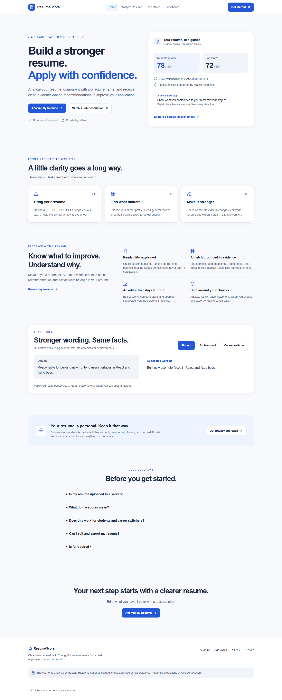

> Publication release policy: `next.config.ts` forces `AI_PAID_ENABLED=false` in compiled builds regardless of remote environment values. Paid AI controls are disabled and labeled in the UI. Removing this lock requires a separately reviewed release.

# ResumeScore

ResumeScore helps candidates review resume text, understand heuristic quality and job-alignment scores, edit their documents, and export improved versions. It does not predict hiring outcomes, certify ATS compatibility, or independently verify qualifications.

**V3 status: light-first UI and workflow candidate for protected Preview. Production remains NO-GO pending independent validation and dependency risk resolution/owner acceptance. Paid AI is disabled.** See [V3 design system](docs/V3_DESIGN_SYSTEM.md), [functional QA](docs/V3_FUNCTIONAL_QA.md), [visual QA](docs/V3_VISUAL_QA.md) and [Preview readiness](docs/V3_DEPLOYMENT_READINESS.md). Earlier V2/V2.1/V2.2 reports are historical evidence; their independent-validation release gates still apply.

## Features

- PDF, DOCX, UTF-8 TXT and pasted text, with extraction review before scoring.
- Browser-only deterministic analysis by default; optional server processing.
- Six career-level weight profiles, evidence explanations and separate general-quality/job-alignment scores.
- Required/preferred/optional job terminology, with reduced credit for unsupported mentions.
- ATS readability estimates with explicit limitations.
- Local section editing, reordering, undo/reset, original-text comparison and live preview.
- TXT and DOCX downloads; PDF through browser print. Review pagination before sharing.
- Optional Claude/Gemini critique and cover-letter drafts, with external-processing consent. Heuristic functionality works without provider keys.
- Opt-in local history, JSON export, deletion and reopening saved resume text.



## Architecture and stack

Next.js 16.4.2, React 19, TypeScript, Tailwind 4, PDF.js, Zod, zip.js, docx, Vitest, Playwright and axe. Server AI providers use the Anthropic and Google GenAI SDKs. No database or account service is required.

Browser extraction → review → shared deterministic parser/scorer → evidence dashboard → local section editor/export. Optional server/AI paths are explained before use. See [architecture](docs/ARCHITECTURE.md) and [scoring methodology](docs/SCORING_METHODOLOGY.md).

## Local development

Use Node.js 22 or newer with npm:

```sh
npm ci
npm run dev
```

Open http://localhost:3000. No provider key is required for deterministic functionality.

Optional server-only configuration in `.env.local`:

```dotenv
ANTHROPIC_API_KEY=your-key
# Or:
GEMINI_API_KEY=your-key
# GOOGLE_API_KEY is accepted as a Gemini fallback.
# GEMINI_MODEL can select the configured Gemini model.
```

Never prefix provider keys with `NEXT_PUBLIC_`. Provider selection is Anthropic, then Gemini, then heuristic. Model availability and provider billing/retention must be verified for the deployment; this change did not perform successful live provider calls. Explicit consent is required before external processing even if keys are present.

## Security and privacy

Browser-only analysis sends no resume or job text to application APIs. Server analysis does transmit text to ResumeScore. Cover-letter generation is server-based and discloses this separately. External AI requires opt-in; provider retention depends on the configured account. XML prompt delimiters and JSON schemas do not guarantee injection resistance or factual accuracy.

History saving defaults off. Enabled history stores full text in this browser until deletion. Export/delete controls are on History. The application does not intentionally persist server request bodies or log raw provider errors. Hosting metadata retention requires operational review.

API requests have byte, string, collection, nesting, origin and read-time limits. General endpoint throttling remains process-local. Paid AI additionally requires a shared atomic Redis budget; missing configuration or storage failure disables paid calls. Arbitrary job URL import is disabled until restricted egress can be configured; paste the job description instead. See [security and privacy](docs/SECURITY_AND_PRIVACY.md).

## Verification

```sh
npm run typecheck
npm run lint
npm test
npm run evaluate:release
npm run build
npx playwright install chromium firefox webkit
npm run test:e2e
npm run test:cross-browser
npm audit --omit=dev
```

Windows with Edge already installed:

```powershell
$env:PLAYWRIGHT_CHANNEL='msedge'
npm run test:e2e
```

For unattended Windows runs interrupted by Modern Standby, use `& .\tools\test-local-windows.ps1` with the same environment. It requests temporary system wakefulness during the suite and releases it on exit; it does not change saved power settings or screen locking. `-Preview` invokes the existing remote-suite runner instead; use it only through authenticated Vercel `env run` with the intended `BASE_URL`.

Vitest uses one thread to avoid the observed Windows sandbox temporary-file issue. The older `npm run verify:e2e` command is an API smoke script, not the browser E2E suite. See [cross-browser validation](docs/CROSS_BROWSER_VALIDATION.md) and [test report](docs/TEST_REPORT.md) for scope and limitations. CI runs Chromium, Firefox and WebKit checks; selectable PDF automation is Chromium-only. Native Safari, screen-reader speech and native print/Office validation remain manual gates.

## Deployment

Existing production: https://resumescore-phi.vercel.app/

The feature branch is published to GitHub and protected Vercel Previews. PR #1 remains draft; main and the existing production deployment retain the original release. Address the [final release gates](docs/FINAL_RELEASE_GATE_MATRIX.md) before requesting final production approval. No paid AI activation, production environment change or domain change is included.

## Limitations and roadmap

- Scoring remains an editorial, predominantly technical rubric; no independent calibration or hiring-outcome validation exists.
- DOCX extracts main document paragraphs, including nested text-box paragraphs once. Headers/footers and images are not extracted; geometric text-box/table order needs review. No OCR.
- PDF print pagination and DOCX layout need manual review across Word, LibreOffice and browsers.
- AI drafts require fact checking; semantic factuality is not guaranteed.
- The Redis budget adapter requires configured infrastructure and live multi-instance validation before paid AI activation. Heuristic fallback remains available.
- Accessibility automation is scoped and does not certify WCAG compliance or replace screen-reader testing.
- Broader domain taxonomies, independently reviewed extraction/matching benchmarks, calibrated candidate profiles and per-role evaluation remain future work.

## V2 changes

Security containment, consent and local analysis; bounded file/API processing; truthful heuristic outputs; career rubrics; evidence-aware matching; editing/export; history opt-in; privacy documentation; accessibility fixes; security dependency updates and browser tests. The [audit](docs/RESUMESCORE_V2_AUDIT.md) records original findings, and [implementation status](docs/IMPLEMENTATION_STATUS.md) distinguishes finished, partial and unverified work.

## V2.1 hardening

Source-provenance rewrite checks and explicit approval, shared fail-closed AI budgets, conservative provider fallback, evidence-based skill limits, negation handling, PDF worker cleanup, export links and broader journey tests. See [AI controls](docs/AI_COST_CONTROLS.md), [factuality evaluation](docs/AI_FACTUALITY_EVALUATION.md), and [baseline](docs/V2_1_BASELINE.md). Configure from `.env.example`; a provider key alone never enables paid calls.
## V2.2 preview candidate

V2.2 adds evidence-based version comparison, job-gap review, structured section selection and fixes for skill matching, project parsing and score display. Paid AI remains disabled. See [implementation](docs/V2_2_IMPLEMENTATION.md), [benchmarks](docs/V2_2_BENCHMARKS.md), [test evidence](docs/V2_2_TEST_REPORT.md) and [release gates](docs/V2_2_RELEASE_READINESS.md). PR #1 remains draft; production promotion is not authorized.

Final hardening fixes duplicate nested-DOCX text, bounds CI permissions/execution and adds an [offline review package](evaluation/README.md). The package measures private, source-labeled datasets without exporting candidate text or claiming that synthetic expectations are independent validation. See [scoring](docs/FINAL_SCORING_VALIDATION.md), [extraction](docs/FINAL_EXTRACTION_VALIDATION.md) and [dependency resolution](docs/DEPENDENCY_SECURITY_RESOLUTION.md).
