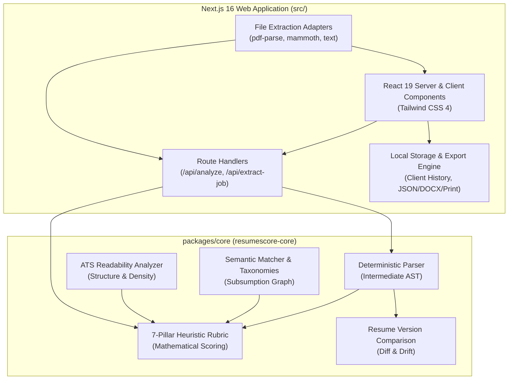
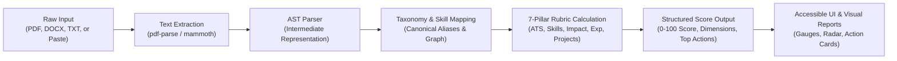

# ResumeScore Architecture & System Design

ResumeScore is architected as a modular monorepo cleanly separating the **deterministic, framework-agnostic core engine** from the **Next.js web application and UI presentation layer**.

---

## 1. High-Level Monorepo Architecture

---

## 2. Data Flow Pipeline

### Pipeline Steps:

1. **Document Intake & Validation**:
   - Files are accepted via drag-and-drop or file selection.
   - Files are strictly validated: max 5 MB, magic byte inspection (`application/pdf`, `application/vnd.openxmlformats-officedocument.wordprocessingml.document`, `text/plain`).
   - PDFs are limited to 20 pages; scanned image-only PDFs trigger an explicit OCR warning.
2. **Text Normalization**:
   - PDF/DOCX extractors extract raw text chunks while standardizing unicode bullets, text box boundaries, and multi-line breaks.
3. **Deterministic AST Parsing (`parseResume`)**:
   - Segments standard and compound sections (`summary`, `experience`, `education`, `skills`, `projects`, `certifications`).
   - Extracts candidate contact information (name, email, phone, location, LinkedIn, GitHub).
   - Resolves structured work experience entries with dates, duration, remote/hybrid tags, and achievement bullet points.
4. **Taxonomy & Semantic Matching (`matchJob`, `buildSkillMatrix`)**:
   - Maps detected terms against the 500+ skill taxonomy.
   - Evaluates direct matches, canonical aliases (e.g. `k8s` -> `Kubernetes`), and subsumption relationships (e.g. `FastAPI` implies `Python` ecosystem).
5. **Deterministic Heuristic Rubric Calculation (`scoreResume`)**:
   - Evaluates 7 distinct pillars:
     1. ATS Readability Estimate (15%)
     2. Job Skill Match (25% in job match mode, normalized in general mode)
     3. Experience Relevance & Recency (20%)
     4. Impact & Quantifiable Metrics (15%)
     5. Projects & Portfolio (10%)
     6. Structure & Readability (10%)
     7. Profile & Contact Completeness (5%)
   - Computes deterministic score contributions and prioritized action items.
6. **UI Rendering**:
   - Rendered using React 19 components with WCAG 2.1 AA accessibility, high-contrast dark/light mode, and full keyboard navigation.

---

## 3. Component Boundaries & Constraints

| Component | Location | Allowed Dependencies | Runtime Constraints |
| :--- | :--- | :--- | :--- |
| **Core Engine** | `packages/core` | **None** (`dependencies: {}`) | Must be 100% pure TypeScript, zero network calls, zero external AI APIs, builds to dual CJS/ESM with declaration files. |
| **Web Adapters** | `src/lib/` | `pdf-parse`, `mammoth`, `zod` | Runs on Next.js server runtime or Node.js. Performs file extraction and validation. |
| **Web Application** | `src/app/`, `src/components/` | `next`, `react`, `lucide-react`, `tailwindcss` | Client and Server Components. Handles responsive layout, local history, and user interactions. |
| **Evaluation** | `evaluation/` | `vitest`, `fast-check` | Non-PII synthetic benchmarks and offline human review runner. |

---

## 4. Security & Privacy Guarantees

- **No Remote Database**: ResumeScore does not maintain a remote database of candidate resumes.
- **Client-Side History**: History is written to browser `localStorage` only when explicitly enabled by the user. Users can export or clear their data at any time.
- **API Boundary Protection**:
  - `validation/request.ts` enforces content-type, origin checks, payload byte limits, and request timeouts.
  - Error logs record event names, never user-submitted resume text or contact information.
